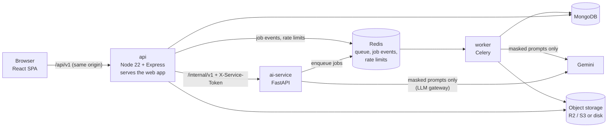

# DataBridge AI

DataBridge AI turns messy customer data from several systems (a CRM export, a billing sheet, a
support tool) into one clean, trusted customer table. It profiles each file, maps its columns to
one schema, finds the records that belong to the same person, builds a golden record for each
customer, writes and tests the SQL that produces the final table, and checks its quality. AI
proposes at every step, a person approves, and no raw personal data is ever sent to a language
model.

**Status:** milestones M1 to M6 are done (foundation, upload and profiling, mapping, matching and
golden records, SQL and quality, dashboard and assistant). Gate 3 (security, privacy and
free-hosting review) is nearly done: this is its polish and documentation step, before the free
deployment.

Approved designs (Figma, shadcn/ui kit): [all screens](docs/design/all-screens.png).

## Architecture



- The browser talks only to the api (`/api/v1`). The api serves the built web app from the same
  origin, so the refresh cookie can stay `SameSite=Strict`
  ([ADR 0027](docs/adr/0027-same-origin-and-access.md)).
- The api calls the ai-service (`/internal/v1`, `X-Service-Token`), which is never exposed to
  the browser. Long work runs as background jobs on a Celery worker with live progress over SSE
  ([ADR 0010](docs/adr/0010-background-jobs.md)).
- On the free tier the worker runs inside the ai-service container and files go to a private
  Cloudflare R2 bucket ([ADR 0026](docs/adr/0026-free-tier-runtime.md)).

```
apps/web/          React 18 + TypeScript + Vite + Tailwind + shadcn/ui (browser UI)
apps/api/          Node 22 + Express + TypeScript + Mongoose + Zod (public API, auth, roles, audit)
apps/ai-service/   Python 3.12 + FastAPI + Pydantic v2 + Celery (profiling, mapping, matching, SQL, RAG)
eval/              synthetic ground-truth generator and evaluation scripts
infra/             docker-compose files and nginx config
docs/              API reference, web app, evaluation, deployment, ADRs
```

## Features, step by step

| Step                | What you get                                                                                                                                                                        |
| ------------------- | ----------------------------------------------------------------------------------------------------------------------------------------------------------------------------------- |
| **Sources**         | Upload CSV or XLSX files (size, row and zip-bomb guards; content sniffing), preview them, name each source system.                                                                  |
| **Profile**         | Per column: type, empty %, distinct values, patterns and flags. Sample values are masked by default.                                                                                |
| **Mapping**         | Rules plus the LLM suggest a target field for each column, with a confidence and a reason. Accept, reject or change each one, or accept all High-confidence suggestions.            |
| **Matching**        | Standardise values, find candidate pairs (multi-key blocking), score them with explainable Fellegi-Sunter weights, let the AI review only the hard pairs from evidence, not values. |
| **Match Review**    | Customers with their records side by side and a golden record with provenance. Approve, split or merge. Link straight to a customer with `?customer=<id>`.                          |
| **Pipeline**        | The SQL agent drafts the query for the final table, a validator and a locked sandbox run it, and tests compare it with the golden records. Approve a version, then export CSV/XLSX. |
| **Data quality**    | Completeness, validity, uniqueness, consistency, freshness and volume rules with warn/fail thresholds per project (defaults shown in the editor), and a report history.             |
| **Dashboard**       | Pipeline progress, review activity, AI usage and cost, quality trend and benchmark results.                                                                                         |
| **Assistant**       | Ask questions about the project. Answers cite their sources (decisions, mappings, quality runs, SQL versions, docs) and refuse questions holding personal data.                     |
| **Roles and audit** | `admin`, `data_engineer`, `data_steward`, `viewer`, checked with project membership on every route. Every decision is audited and history shows who did it by name.                 |

Details: [API reference](docs/api.md) and [web app](docs/web-app.md).

## Results (synthetic data)

Every number below is measured on **synthetic data** from the ground-truth generator
([ADR 0008](docs/adr/0008-ground-truth-dataset.md)), not on real customers. Holdout sets were not
used to tune the step they grade. How each is measured: [evaluation](docs/evaluation.md).

| Step           | Result (synthetic data)                                                                                                          | Source                                                      |
| -------------- | -------------------------------------------------------------------------------------------------------------------------------- | ----------------------------------------------------------- |
| Column mapping | Unseen-header holdout (44 columns): 72.7% with rules only, **81.8%** with Gemini; High-confidence wrong answers 4 → 2            | [ADR 0013](docs/adr/0013-mapping-evaluation-and-holdout.md) |
| Blocking       | **99.54%** pair completeness (1,288 of 1,294 true pairs), **99.99%** reduction ratio (seed 42, 6,095 records)                    | [ADR 0015](docs/adr/0015-blocking.md)                       |
| Pair scoring   | Untouched holdout (seed 2028): **100%** precision, **99.18%** recall, **0** false matches                                        | [ADR 0016](docs/adr/0016-pair-scoring.md)                   |
| Golden records | Untouched holdout (seed 2029, run once): **99.96%** of people rebuilt exactly (4,998), 0 over-merged                             | [ADR 0018](docs/adr/0018-clusters-and-golden-records.md)    |
| Data quality   | Fault injection (blanked emails, broken phones, duplicate ids, impossible dates, wrong PIN zones): **100%** precision and recall | [ADR 0022](docs/adr/0022-data-quality.md)                   |
| SQL validator  | **26 of 26** malicious queries refused; Mock agent and reference query pass all 6 table tests                                    | [ADR 0021](docs/adr/0021-sql-agent.md)                      |
| Assistant      | **100%** refusal of questions holding personal data; 0 staged values in prompts or answers                                       | [ADR 0025](docs/adr/0025-assistant.md)                      |

CI keeps a floor a little below each offline number, so a regression fails the build.

## Privacy and security

- **No raw personal data to an LLM.** Every model call goes through one gateway that masks
  personal values, then logs tokens, cost and latency
  ([ADR 0006](docs/adr/0006-llm-gateway-and-pii-masking.md)). Pair review sends evidence such as
  "phones agree", never the values, and a leak scan blocks any prompt that still holds one
  ([ADR 0017](docs/adr/0017-ai-pair-review.md)).
- **Leak guards around the assistant.** Questions holding an email, phone or similar are refused
  and not stored. The knowledge index holds no staged values, and every answer is scanned before
  it is shown ([ADR 0024](docs/adr/0024-knowledge-index.md),
  [ADR 0025](docs/adr/0025-assistant.md)).
- **SQL sandbox.** A layered validator (one read-only `SELECT`, table and function allowlists)
  runs first. Queries then run in DuckDB with no external access, a locked configuration and
  memory, thread and time limits ([ADR 0021](docs/adr/0021-sql-agent.md)).
- **Web hardening.** A strict Content-Security-Policy (`script-src 'self'`, no inline scripts),
  HSTS, `frame-ancestors 'none'`, `nosniff`, and formula-safe exports
  ([ADR 0027](docs/adr/0027-same-origin-and-access.md),
  [ADR 0020](docs/adr/0020-export.md)).
- **Accounts.** bcrypt (cost 12), 15-minute access tokens, rotated and hashed refresh tokens with
  reuse detection, and rate limits shared through Redis
  ([ADR 0005](docs/adr/0005-auth-and-sessions.md),
  [ADR 0028](docs/adr/0028-privacy-and-quota-hardening.md)).
- **Invite-only on the free deployment.** Only `BOOTSTRAP_ADMIN_EMAIL` becomes admin, and
  `REGISTRATION_MODE=invite` (or `closed`) keeps strangers from using up the free quotas.
- **Names, not emails.** History lines name people by their display name (or the part of their
  email before the @). Other users' emails are never shown.

## Run locally

Requires Docker with Compose v2.

```bash
cp .env.example .env    # then replace the change-me secrets
docker compose --env-file .env -f infra/docker-compose.yml up --build
```

| URL                                 | What                                                         |
| ----------------------------------- | ------------------------------------------------------------ |
| http://localhost:4000               | Web UI served by the api itself (single origin, as deployed) |
| http://localhost:8080               | Web UI through nginx (also proxies `/api/` to the api)       |
| http://localhost:4000/api/v1/health | API health                                                   |

Set `BOOTSTRAP_ADMIN_EMAIL` in `.env` to get an admin. The ai-service, worker, MongoDB and Redis
are reachable only inside the compose network. `LLM_PROVIDER=mock` runs everything without an
API key. To try the free-hosting layout (S3 test server, worker inside the ai-service), add
`-f infra/docker-compose.s3.yml`. Stop with `Ctrl+C`; `down -v` removes the data volumes.

Without Docker (Node 22 and Python 3.12):

```bash
npm install && npm run dev -w apps/api      # http://localhost:4000/api/v1/health
npm run dev -w apps/web                     # http://localhost:5173
cd apps/ai-service && python -m venv .venv && . .venv/bin/activate && pip install -e ".[dev]"
uvicorn app.asgi:app --reload --port 8000   # http://localhost:8000/internal/v1/health
```

## Deploy (free tier)

Everything runs on free plans ([ADR 0026](docs/adr/0026-free-tier-runtime.md)), described by the
Render Blueprint [`render.yaml`](render.yaml) ([ADR 0031](docs/adr/0031-render-blueprint.md)):

| Piece         | Free service                                                                                                                 |
| ------------- | ---------------------------------------------------------------------------------------------------------------------------- |
| api + web app | Render web service `databridge-api` (Docker, `apps/api/Dockerfile`); health check `/api/v1/health`                           |
| ai-service    | Render web service `databridge-ai` (Docker, `apps/ai-service/Dockerfile`), worker inside; health check `/internal/v1/health` |
| Redis         | Render Key Value `databridge-redis` (free, internal only)                                                                    |
| MongoDB       | MongoDB Atlas M0 (512 MB), a database user with `readWrite` on the app database only                                         |
| Files         | Cloudflare R2: a private bucket and a token scoped to it (object read and write)                                             |
| LLM           | Gemini free tier, paced to 12 requests a minute and a daily budget shared by both services                                   |

Render → New → Blueprint → this repository creates all three; Render makes the JWT secrets and the
service token, and asks only for the values that come from Atlas, R2, Gemini and you. Register
`BOOTSTRAP_ADMIN_EMAIL` yourself before sharing the URL. CI checks the Blueprint against both
services' config schemas. Step-by-step guide, smoke test and troubleshooting:
[deploy on free hosting](docs/deploy-free-tier.md). Never commit real values.

## Screenshots

CI takes a screenshot of every screen in the end-to-end tests and uploads them as the
`web-screenshots` artifact of each run (Actions → CI → a run → Artifacts): `00-create-account`,
`01-sign-in`, `02-projects`, `03-new-project-dialog`, `04-project-sources`, `05-sources`,
`06-profile`, `07-mapping-review`, `08-match-review`, `09-pipeline`, `10-quality`,
`11-dashboard`, `12-assistant`. A failed run also uploads `playwright-report`.

## Tests and CI

| Command (from the repo root)                                                        | What                                     |
| ----------------------------------------------------------------------------------- | ---------------------------------------- |
| `npm run lint && npm run typecheck && npm test`                                     | web and api: lint, types, unit + API     |
| `cd apps/ai-service && ruff check . && ruff format --check . && mypy app && pytest` | ai-service (mypy strict, coverage floor) |
| `cd eval && pytest`                                                                 | evaluation floors on synthetic data      |
| `npm run e2e -w apps/web`                                                           | Playwright + axe against a running stack |

GitHub Actions (`.github/workflows/ci.yml`) runs on every pull request and push to `main`:

- **js**: format, lint, types, web tests, api tests with coverage against MongoDB and Redis, and
  the production build.
- **python** and **eval**: ruff, mypy, pytest (a real Celery worker against Redis and MongoDB).
- **docker**: builds every image, starts the stack in the free-hosting layout with throwaway
  secrets, smoke-tests every pipeline step through the proxy (Mock LLM), checks that the
  ai-service is not reachable from the host and that containers run as non-root, then runs the
  Playwright end-to-end and accessibility (axe) tests.

The **Live eval** workflow (`live-eval.yml`) is manual only: it sends synthetic samples to Gemini
to measure mapping, pair review, the SQL agent, retrieval and the assistant
([evaluation](docs/evaluation.md)).

## Architecture decisions

| ADR                                                         | Decision                                                      |
| ----------------------------------------------------------- | ------------------------------------------------------------- |
| [0001](docs/adr/0001-monorepo-structure.md)                 | Monorepo structure                                            |
| [0002](docs/adr/0002-two-services-node-and-python.md)       | Two backend services: Node API and Python AI service          |
| [0003](docs/adr/0003-tooling-choices.md)                    | Tooling and version choices                                   |
| [0004](docs/adr/0004-containers-and-ci.md)                  | Containers and CI                                             |
| [0005](docs/adr/0005-auth-and-sessions.md)                  | Authentication, sessions and project access                   |
| [0006](docs/adr/0006-llm-gateway-and-pii-masking.md)        | LLM gateway and PII masking                                   |
| [0007](docs/adr/0007-frontend-architecture-and-sessions.md) | Frontend architecture and browser sessions                    |
| [0008](docs/adr/0008-ground-truth-dataset.md)               | Ground-truth dataset                                          |
| [0009](docs/adr/0009-file-uploads-and-storage.md)           | File uploads and storage                                      |
| [0010](docs/adr/0010-background-jobs.md)                    | Background jobs with Celery, Redis and live progress          |
| [0011](docs/adr/0011-column-profiling.md)                   | Column profiling                                              |
| [0012](docs/adr/0012-column-mapping.md)                     | Target schema and hybrid column mapping                       |
| [0013](docs/adr/0013-mapping-evaluation-and-holdout.md)     | Mapping evaluation and the unseen-header holdout              |
| [0014](docs/adr/0014-standardisation.md)                    | Standardisation into staged records                           |
| [0015](docs/adr/0015-blocking.md)                           | Candidate pairs with multi-key blocking                       |
| [0016](docs/adr/0016-pair-scoring.md)                       | Explainable pair scoring with Fellegi-Sunter weights          |
| [0017](docs/adr/0017-ai-pair-review.md)                     | Privacy-preserving AI review of maybe pairs                   |
| [0018](docs/adr/0018-clusters-and-golden-records.md)        | Clusters and golden records with provenance                   |
| [0019](docs/adr/0019-match-review-decisions.md)             | Match Review decisions (approve, split, merge)                |
| [0020](docs/adr/0020-export.md)                             | Export golden records (CSV and XLSX)                          |
| [0021](docs/adr/0021-sql-agent.md)                          | SQL agent for the final customer table                        |
| [0022](docs/adr/0022-data-quality.md)                       | Data quality checks on the final customer table               |
| [0023](docs/adr/0023-dashboard.md)                          | Project dashboard metrics                                     |
| [0024](docs/adr/0024-knowledge-index.md)                    | Knowledge index for the project assistant                     |
| [0025](docs/adr/0025-assistant.md)                          | Project assistant answers (grounded generation)               |
| [0026](docs/adr/0026-free-tier-runtime.md)                  | Free-tier runtime                                             |
| [0027](docs/adr/0027-same-origin-and-access.md)             | Same origin, security headers and access control              |
| [0028](docs/adr/0028-privacy-and-quota-hardening.md)        | Masked profile samples, shared AI quota and daily budget      |
| [0029](docs/adr/0029-concurrency-and-retention.md)          | Safe concurrent approvals and job starts, data retention      |
| [0030](docs/adr/0030-names-defaults-links-and-bundle.md)    | Display names, threshold defaults, customer links, web bundle |
| [0031](docs/adr/0031-render-blueprint.md)                   | Render Blueprint for the free deployment                      |

## License

[MIT](LICENSE)
